<div align="center">

# Scene Detector

Prende un film e ne fa un catalogo navigabile: shot, personaggi, dialoghi e descrizioni.<br>
Gira in locale su Apple Silicon, senza API esterne.


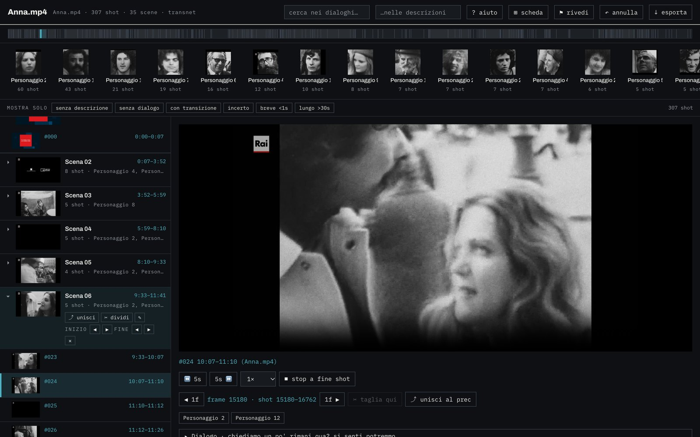

<sub><i>Il catalogo di </i>Anna<i> (Grifi, Sarchielli, 1975): 307 shot, 35 scene, cast ricavato dai volti.</i></sub>

</div>

---

Il repository contiene due cose. La seconda usa l'output della prima.

| | | Domanda | Risultato |
|---|---|---|---|
| **I** | [Scene Detector](#parte-i--scene-detector) | Com'è fatto questo film? | `manifest.json` e `index.html`, con confini, personaggi, dialogo e descrizione di ogni shot |
| **II** | [Il confronto](#parte-ii--il-confronto-anna-nel-fuori-campo) | Da quale punto del girato viene ogni pezzo del montato? | per ognuno dei 307 shot di *Anna*, la parte del *Fuori campo* e il minuto |

I termini tecnici (shot, ASL, embedding, IoU, F1, distribuzione nulla…) sono spiegati nel
[Glossario](#glossario), in fondo.

<details>
<summary><b>Indice</b></summary>

- **Parte I, Scene Detector**:
  [In breve](#in-breve) · [Avvio rapido](#avvio-rapido) · [La pipeline](#la-pipeline) · [Modelli](#modelli) ·
  [Gli stadi](#gli-stadi) · [Il catalogo su disco](#il-catalogo-su-disco) · [La UI](#la-ui) ·
  [Comandi](#comandi) · [Valutazione](#valutazione) · [Pesi](#pesi) · [Sviluppo](#sviluppo)
- **Parte II, Il confronto**:
  [La domanda](#la-domanda) · [Input](#input) · [Il metodo](#il-metodo) · [Dal 70% al 92%](#dal-70-al-92) ·
  [Comandi](#comandi-1) · [Output](#output) · [Parametri](#parametri) · [Ipotesi smentite](#ipotesi-smentite)
- [Glossario](#glossario): [film e video](#film-e-video) · [modelli](#i-modelli) · [misure](#misure-e-statistiche)
- [Crediti e licenze](#crediti-e-licenze)

</details>

<br>

# Parte I · Scene Detector

## In breve

| Input | Output |
|---|---|
| un video che `ffmpeg` sa leggere (`.mp4`, `.mkv`, `.mov`…) | `clips/<Film>/manifest.json`, una riga per shot con tutto quello che la pipeline ha ricavato |
| *(opzionale)* una cartella `<Nome>/*.jpg` con le foto dei personaggi | `clips/<Film>/index.html`, la UI: si apre col doppio click, anche offline |
| *(opzionale)* un manifest corretto a mano nella UI | `clips/<Film>/clip/scene-NNN.mp4`, una clip per shot (si può saltare) |
| | `clips/index.html`, la galleria con tutti i film catalogati |

## Avvio rapido

```bash
brew install ffmpeg                       # l'unico requisito di sistema
./install.sh                              # venv, dipendenze, pesi di TransNetV2 (31 MB, sha256 verificato)

scene-detector "FILM.mp4" --all -o clips/ # shot, personaggi, dialoghi, descrizioni
open clips/FILM/index.html                # basta il doppio click, nessun server
```

> [!TIP]
> Con `./install.sh --models` scarichi subito anche Whisper, il VLM, i modelli dei volti e DINOv2
> (~4 GB). Se no li scarica il primo run che li usa.

<details>
<summary>Installazione a mano, un extra alla volta</summary>

Gli import pesanti stanno dentro i rami della pipeline. Puoi quindi usare `--asr` senza `--vlm`, e
un extra che manca dà errore solo quando chiedi lo stadio che lo usa.

```bash
python3.13 -m venv .venv && source .venv/bin/activate
pip install -e .                 # base: scenedetect, numpy, typer, tqdm
pip install -e '.[neural]'       # TransNetV2: torch, pillow
pip install -e '.[asr]'          # dialoghi: faster-whisper
pip install -e '.[vlm]'          # descrizioni: mlx-vlm (Apple Silicon)
pip install -e '.[faces]'        # personaggi: insightface, onnxruntime
pip install -e '.[characters]'   # --faces-refine: DINOv2
pip install -e '.[all]'          # tutto quello che serve a --all
scene-detector-setup             # pesi in weights/, sha256 verificato
```

Serve Python 3.10 o più recente (il progetto è testato su 3.13) e `ffmpeg`/`ffprobe` nel `PATH`.
Apple Silicon serve solo per il VLM, che usa MLX. Il resto gira ovunque.

</details>

## La pipeline

`--all` esegue gli stadi uno dopo l'altro. Ogni stadio legge `manifest.json`, aggiunge la sua parte
e lo riscrive. Lo stato del run è tutto lì: se si interrompe, riparte da quel file.

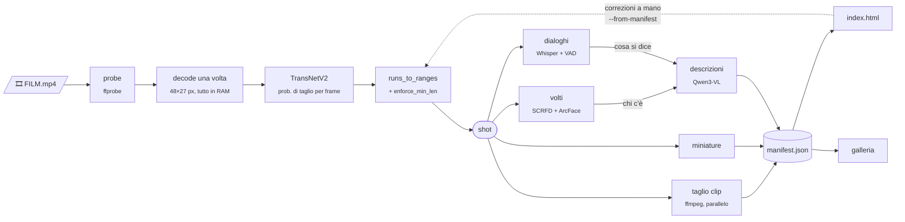

## Modelli

| Stadio | Modello | Libreria e runtime | Device | Peso | Flag |
|---|---|---|---|---|---|
| Shot boundary | TransNetV2 (CNN 3D) | PyTorch | MPS | 31 MB | default |
| Shot boundary, baseline | PySceneDetect (classico, sui colori) | OpenCV | CPU | nessuno | `-d pyscenedetect` |
| Volti, rilevamento | SCRFD (`buffalo_l`) | InsightFace, ONNX Runtime | CoreML, poi CPU | ~300 MB | `--faces` |
| Volti, identità | ArcFace (`buffalo_l`), embedding a 512 dimensioni | InsightFace, ONNX Runtime | CoreML, poi CPU | incluso sopra | `--faces` |
| Figure non umane | DINOv2-L (with registers) con una testa adattata al film | transformers | MPS | ~1,2 GB | `--faces-refine` |
| Dialoghi | Whisper `large-v3-turbo` con VAD | faster-whisper, CTranslate2 | CPU | ~1,6 GB | `--asr` |
| Descrizioni | Qwen3-VL-8B-Instruct-4bit | mlx-vlm | MLX (GPU) | ~5 GB | `--vlm` |
| Chi parla | binario esterno `speech` | | | | `--diarize` |
| Scene | Optimal Sequential Grouping su istogrammi HSV | NumPy | CPU | nessuno | `--scenes` |

Il clustering dei volti l'abbiamo scritto noi: greedy agglomerativo sulla distanza coseno, solo
NumPy. Una spiegazione semplice di ogni modello è nel [Glossario](#i-modelli).

## Gli stadi

### 1. Rilevamento degli shot

Il video si decodifica una volta sola a 48×27 px, la risoluzione con cui lavora TransNetV2, e i
frame restano in RAM (~1,25 GB per un film di due ore). TransNetV2 dà a ogni frame una probabilità
di taglio. Gli shot li ricava il post-processing:

```text
probs ─► runs_to_ranges(threshold, min_peak) ─► scenes_from_ranges ─► enforce_min_len(5) ─► list[Scene]
```

<p align="center">
  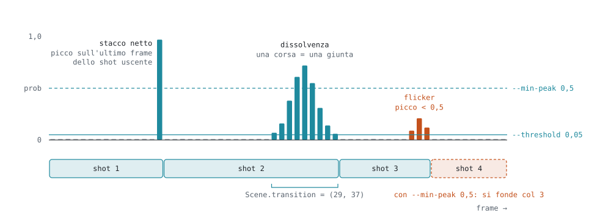
</p>

- Una corsa di frame consecutivi sopra soglia conta come una transizione sola. Lo shot uscente la
  include e quello entrante parte dal frame dopo, così gli shot restano contigui e coprono tutto il
  film. La durata della transizione si salva in `Scene.transition`.
- In uno stacco netto il picco cade sull'ultimo frame dello shot uscente (96–97% di 1200 hard cut
  misurati).
- `--threshold` decide dove una transizione comincia e finisce. `--min-peak` decide se c'è.
- `Scene.end_frame` è inclusivo, in tutto il progetto.

> [!IMPORTANT]
> La soglia di default è 0,05 e va insieme a `--min-scene-len 5`. Se cambi solo una delle due il
> risultato peggiora. Su 1634 transizioni annotate il recall sale da 0,088 a 0,270, e sugli stacchi
> netti da 0,81 a 0,93. In cambio gli shot aumentano del 32%. Dettagli in
> [`plan/VERBALE.md`](plan/VERBALE.md) §3.4.

> [!NOTE]
> Per materiale rovinato usa `--min-peak 0.5`. Nel restauro di *Anna* (Portapak, 1975) il rumore
> della pellicola produce corse larghe e deboli. Su un campione guardato alla cieca nessuna delle 24
> era uno stacco vero, mentre lo erano 12 controlli su 12. Con `--min-peak 0.5` gli shot scendono
> da 967 a 307 e le 27 dissolvenze vere restano intatte. Alzando la soglia a 0,5 avresti gli stessi
> 307 shot, ma una sola dissolvenza. Di default è spento, perché su un film pulito quelle corse sono
> quasi sempre stacchi veri.

La confidenza di un confine è la probabilità che TransNetV2 dà al taglio che lo apre. È un numero
fra 0 e 1, e la UI la usa per ordinare la coda dei confini da rivedere.

### 2. Taglio delle clip

`ffmpeg` gira in parallelo su più core (`-j`, di default tutti meno due). Con `--split-mode` scegli
fra tre modalità:

| Modalità | Cosa fa | Quando usarla |
|---|---|---|
| `copy` *(default)* | copia lo stream senza ricodificare. È velocissima, ma la clip comincia dall'ultimo keyframe prima del punto chiesto, fino a un GOP prima | quasi sempre |
| `reencode` | ricodifica in H.264 CRF 18 + AAC e taglia al frame esatto | quando serve precisione al frame. `--from-manifest` la imposta da solo |
| `none` | non produce clip, e nel manifest `clip` vale `null` | poco spazio su disco, prove |

La UI riproduce sempre il film originale (`video_src` nel manifest) e salta al punto giusto. Il
frame che vedi è quello contato dalla pipeline, qualunque sia la posizione dei keyframe. Per questo
con `none` il catalogo è identico e non duplichi il film.

### 3. Personaggi (`--faces`)

Per ogni shot prende `--faces-frames` fotogrammi. SCRFD trova i volti, ArcFace ne calcola
l'embedding, e poi i volti si raggruppano in personaggi su tutto il film, in due passaggi:

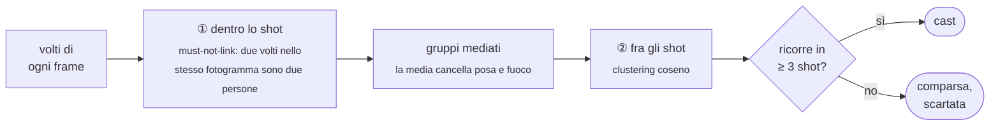

- Il vincolo *must-not-link* tiene separati i due volti di un campo/controcampo.
- Su un film di 3h33 i cluster calano del 31%, con la stessa copertura degli shot, rispetto al
  clustering fatto volto per volto.
- Per entrare nel cast un personaggio deve comparire in almeno `--faces-min-shots` shot diversi
  (conta il numero di shot, quello dei volti no). Su *Rogue One* il cast passa così da 661 a 65.
- Con `--faces-gallery <dir>` (una cartella `<Nome>/*.jpg` per personaggio) i cluster prendono i
  nomi veri. Senza, si chiamano `Personaggio N` e li puoi rinominare o fondere nella UI.
- `--faces-refine` riguarda con DINOv2 i cluster che ArcFace non riconosce come volti umani
  (droidi, elmetti), usando il ritaglio della figura intera.

### 4. Dialoghi (`--asr`)

Usa Whisper tramite faster-whisper. Un VAD trova i tratti con la voce e Whisper li trascrive a
finestre di 30 s, ognuna per conto suo. Così il decoder non entra in loop, e recupera il 7% di
parole in più con il 18% di tempo in più. Ci sono due protezioni, aggiunte dopo due bug:

- La lingua si riconosce sul parlato. Prima si usava l'audio grezzo, e un film che si apriva con un
  cartello muto veniva preso per inglese e trascritto tutto in inglese.
- Un filtro scarta le allucinazioni tipiche di Whisper sull'audio rovinato: frasi fatte («Grazie a
  tutti»), finti crediti dei sottotitoli, ripetizioni a loop.

Ogni segmento di testo va allo shot che contiene il suo punto medio, quindi finisce in uno shot
solo.

### 5. Descrizioni (`--vlm`)

Per ogni shot prende `--vlm-frames` fotogrammi, un po' lontani dai bordi per evitare il frame del
taglio, e li manda a Qwen3-VL-8B tramite mlx-vlm. Il prompt chiede una o due frasi concrete in
italiano. Nel prompt entrano anche i personaggi dello stadio 3 e il dialogo dello stadio 4, segnati
come contesto e con la richiesta di non riassumerli: senza quell'istruzione il modello si mette a
raccontare la trama. Gira a `temperature=0`, quindi lo stesso shot dà sempre la stessa
descrizione. Ci mette circa 5 s per shot e riprende da dove si era fermato.

### 6. Manifest, UI e galleria

Prima di ogni stadio lungo il manifest viene salvato su disco, e lo stadio salta gli shot già
fatti. Fra un run e l'altro i campi si recuperano confrontando il range (`start_frame`,
`end_frame`) e mai l'indice. Se un confine si è spostato, quello shot riparte vuoto: meglio un
campo perso che un campo finito sullo shot sbagliato.

### Fuori da `--all`

| Flag | Cosa fa | Perché è fuori da `--all` |
|---|---|---|
| `--scenes --n-scenes K` | raggruppa gli shot in scene (OSG, solo immagine) | senza `K` la stima automatica dà circa il 40% di scene in meno |
| `--diarize` | dice chi parla in ogni shot (campo `speakers`) | serve il binario esterno `speech` |
| `--faces-refine` | DINOv2 sui cluster che non sono volti | serve solo con personaggi non umani |

## Il catalogo su disco

```text
clips/
├── index.html                 # galleria di tutti i film catalogati
└── FILM/
    ├── manifest.json          # ogni stadio lo completa e lo riscrive
    ├── index.html             # la UI, con i font dentro (~1 MB)
    ├── clip/scene-001.mp4 …   # una clip per shot (non c'è con --split-mode none)
    ├── thumbs/000000.jpg …    # una miniatura per shot, nominata con lo start_frame
    ├── faces/                 # i ritratti del cast
    └── logs/run-<ts>/         # config del run, ambiente, durata di ogni stadio
```

<details open>
<summary><b><code>manifest.json</code></b></summary>

```jsonc
{
  "video": "FILM.mp4", "video_src": "../../FILM.mp4",
  "fps": 23.976, "n_frames": 192701, "duration": 8037.5,
  "detector": "transnet", "n_shots": 2426,
  "cast": [ { "id": 0, "name": "Personaggio 1", "n_faces": 262, "n_shots": 76 } ],
  "cast_params": { "faces_min_shots": 3, "faces_threshold": 0.5 /* parametri con cui è stato fatto il cast */ },
  "shots": [
    { "index": 0, "start_frame": 0, "end_frame": 148,        // end_frame inclusivo
      "start_time": 0.0, "end_time": 6.214,
      "clip": "clip/scene-001.mp4",                         // null con --split-mode none
      "confidence": 0.98,                                    // probabilità del taglio che apre lo shot
      "transition": { "start_frame": 8464, "end_frame": 8467, "n_frames": 4 },  // solo se graduale
      "description": "…", "dialogue": "…", "characters": [0, 3] }
  ]
}
```

</details>

## La UI

In `index.html` correggi i confini, dai i nomi ai personaggi e rivedi i casi dubbi. Ha quattro
viste, la ricerca nei dialoghi e nelle descrizioni, dei filtri e un player che riproduce il film
originale.

<table>
<tr>
<td width="50%">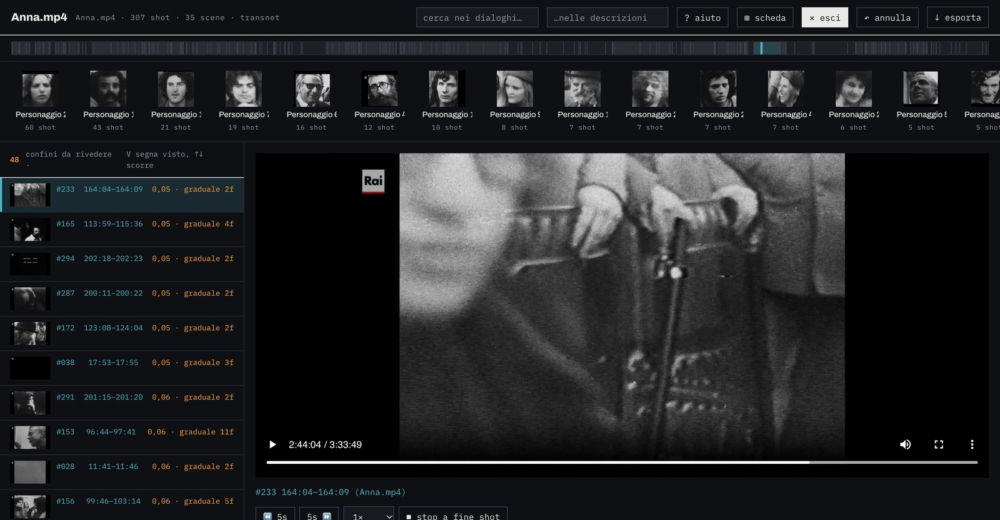</td>
<td width="50%">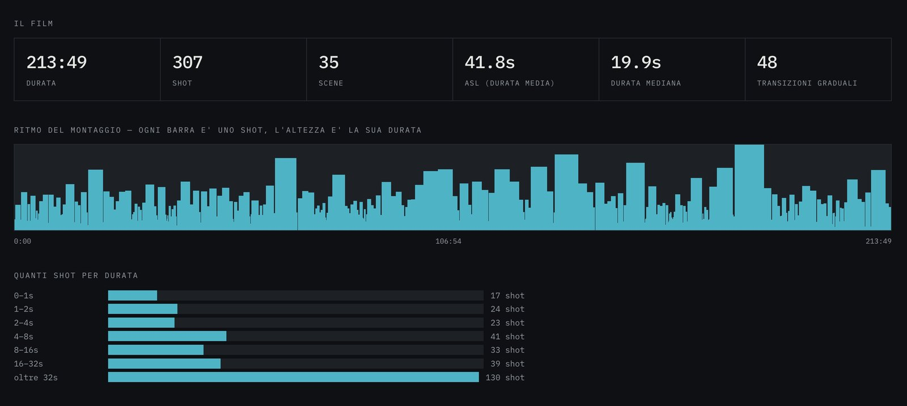</td>
</tr>
<tr>
<td><b>⚑ rivedi</b>: i 48 confini incerti di <i>Anna</i>, dal più dubbio, con confidenza e durata della transizione</td>
<td><b>⊞ scheda</b>: i numeri del film, cioè ASL, ritmo del montaggio, durate e minuti in scena per personaggio</td>
</tr>
</table>

| Tasto | Azione | | Tasto | Azione |
|---|---|---|---|---|
| `S` | taglia lo shot sul frame corrente | | `R` | vista *rivedi* |
| `M` | unisci al precedente | | `T` | vista *scheda* |
| `V` | segna il confine come visto | | `H` | vista *aiuto* |
| `D` / `E` | modifica dialogo / descrizione | | `⌘Z` | annulla |

Puoi esportare in tre formati: JSON (il catalogo corretto), EDL CMX3600 per Premiere o Resolve, SRT
con i dialoghi trascritti.

### Correggere i confini a mano

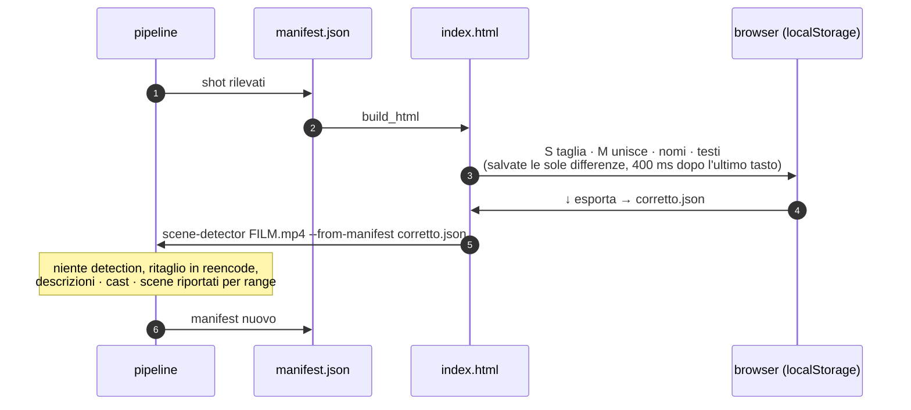

`--from-manifest` usa sempre `reencode`. Un confine messo a mano cade in mezzo a uno shot, lontano
dai keyframe, e con `copy` il taglio finirebbe fino a un GOP prima senza nessun avviso.

## Comandi

Ci sono quattro comandi.

| Comando | Cosa fa |
|---|---|
| `scene-detector VIDEO [flag]` | la pipeline |
| `scene-detector-setup` | scarica i pesi (sha256 verificato) e controlla che ci sia `ffmpeg` |
| `scene-detector-benchmark` | scarica il test set di SHOT e ci misura il detector |
| `scene-detector-index -o clips/` | rifà la galleria dei film |

### `scene-detector`

```bash
scene-detector FILM.mp4 -o clips/                              # solo shot (TransNetV2) e clip
scene-detector FILM.mp4 -d pyscenedetect -o clips/             # baseline classica, senza pesi
scene-detector FILM.mp4 --all --asr-lang it -o clips/          # tutto, con la lingua imposta
scene-detector FILM.mp4 --all --split-mode none -o clips/      # catalogo senza copie del film
scene-detector FILM.mp4 --all --min-peak 0.5 -o clips/         # materiale rovinato (restauri, VHS)
scene-detector FILM.mp4 --scenes --n-scenes 35 -o clips/       # più il raggruppamento in scene
scene-detector FILM.mp4 --from-manifest corretto.json -o clips/ # riparte dai confini corretti
```

<details>
<summary><b>Tutti i flag</b></summary>

| Flag | Default | Descrizione |
|---|---|---|
| `VIDEO` | | il film (argomento posizionale) |
| `-o, --output-dir` | `clips` | cartella radice, l'output va in `<dir>/<nome-film>/` |
| `--all` | off | detection, split, volti, ASR e VLM |
| `--max` | off | `--all` più `reencode` al frame esatto e multi-core |
| `-d, --detector` | `transnet` | `transnet` o `pyscenedetect` |
| `--threshold` | `0.05` | soglia sulle probabilità per frame |
| `--min-scene-len` | `5` | frame minimi per shot. Gli shot più corti si fondono col precedente |
| `--min-peak` | `0.0` | picco minimo di una corsa per contarla come taglio (0 = spento) |
| `--split-mode` | `copy` | `copy`, `reencode` o `none` |
| `-j, --jobs` | `0` | processi ffmpeg in parallelo (0 = core meno 2) |
| `--transnet-weights` | `weights/transnetv2.pth` | pesi di TransNetV2 |
| `--from-manifest` | | prende i confini da un manifest corretto nella UI e salta la detection |
| `--asr` | off | trascrive i dialoghi |
| `--asr-model` | `large-v3-turbo` | da `tiny` a `large-v3-turbo`, o un path |
| `--asr-lang` | auto | lingua ISO (es. `it`). In automatico si riconosce sul parlato |
| `--asr-threads` | `0` | thread CPU (0 = core meno 2) |
| `--vlm` | off | descrizione di ogni shot |
| `--vlm-model` | `mlx-community/Qwen3-VL-8B-Instruct-4bit` | repo `mlx-community` o path |
| `--vlm-frames` | `3` | frame per shot |
| `--faces` | off | riconoscimento dei personaggi |
| `--faces-gallery` | | cartella `<Nome>/*.jpg` per dare i nomi |
| `--faces-frames` | `6` | frame per shot |
| `--faces-threshold` | `0.5` | similarità coseno minima per unire due volti, o un volto alla gallery |
| `--faces-min-score` | `0.5` | `det_score` minimo del rilevatore |
| `--faces-min-px` | `50` | lato minimo del volto in pixel. Sotto, l'embedding è inaffidabile |
| `--faces-min-shots` | `3` | shot diversi in cui deve comparire un personaggio per entrare nel cast |
| `--faces-refine` | off | DINOv2 sui cluster che non sono volti |
| `--faces-refine-threshold` | `0.70` | soglia coseno per DINOv2. Ha una scala sua, diversa da `--faces-threshold` |
| `--diarize` | off | chi parla (binario `speech`) |
| `--scenes` | off | raggruppa gli shot in scene |
| `--n-scenes` | stima | numero di scene. Conviene passarlo: la stima ne trova circa il 40% in meno |

</details>

### `scene-detector-setup`

```bash
scene-detector-setup            # TransNetV2 (31 MB) e controllo di ffmpeg/ffprobe
scene-detector-setup --models   # anche Whisper, VLM, volti, DINOv2 (~4 GB)
scene-detector-setup --force    # riscarica anche quello che c'è già
```

### `scene-detector-benchmark`

```bash
scene-detector-benchmark --limit 50   # 50 video del test set di SHOT (0 = tutti e 200)
```

| Flag | Default | |
|---|---|---|
| `--data-dir` | `prove/shot-dataset` | dove salvare ground truth e video |
| `--limit` | `50` | quanti video usare (0 = tutti) |
| `--tol` | `5` | tolleranza in frame sui confini |
| `--min-iou` | `0.5` | IoU minimo perché una transizione conti come TP |

Il test set di SHOT (CVPR-W 2023: 200 video, 2516 confini, 438 transizioni graduali con inizio e
fine annotati) si scarica da un mirror pubblico su HuggingFace. Gli archivi pesano circa 20 GB, ma
il comando legge l'indice degli zip remoti con richieste HTTP a range e scarica solo i video che gli
servono.

## Valutazione

`scene_detector.evaluation.eval` ha due tipi di metriche, che misurano cose diverse:

| Metrica | Cosa confronta | Cosa non vede |
|---|---|---|
| `prf1(pred, gt, tol)` | i confini come punti, entro `tol` frame | quanto dura una transizione |
| `transition_iou(pred, gt, min_iou)` | le transizioni come intervalli | niente, ma se ci sono solo stacchi netti dice poco |

> [!WARNING]
> L'F1 sui confini, da solo, può ingannare. Prendi una dissolvenza di 24 frame nel ground truth e un
> detector che mette un taglio secco a metà: F1 (`tol=15`) 1,00, `mean_iou` 0,083. Riporta sempre
> `tol` insieme all'F1. Se il ground truth mescola stacchi e graduali, guarda le metriche separate
> per tipo: con 55 graduali in mezzo a 2500 hard cut il meanIoU complessivo è 0,94, ma sulle sole
> graduali è 0,21.

```python
from scene_detector.evaluation.eval import (
    boundaries_from_scenes, boundaries_from_ranges, prf1,
    transitions_from_scenes, transitions_from_ranges, transition_iou)

b = prf1(boundaries_from_scenes(pred), boundaries_from_ranges(gt), tol=5)
t = transition_iou(transitions_from_scenes(pred), transitions_from_ranges(gt), min_iou=0.5)
```

Per le transizioni predette usa `transitions_from_scenes`. Gli shot sono contigui e la durata della
transizione sta in `Scene.transition`: ricavandola dai soli range, ogni dissolvenza sembrerebbe uno
stacco di 2 frame. `benchmark.py` aggrega in modalità micro, cioè somma tp, fp e fn di tutti i video
prima di calcolare le metriche.

## Pesi

La cartella `weights/` non è nel repo. `scene-detector-setup` scarica ogni file in un file
temporaneo, controlla lo sha256 e solo dopo gli dà il nome definitivo, così un download interrotto
non lascia un peso rotto. L'elenco dei pesi è in [`core/weights.py`](scene_detector/core/weights.py).
Il peso di TransNetV2 viene da un mirror su HuggingFace, e tutti i 90 tensori coincidono con la
conversione ufficiale (verificato con `torch.equal`). Un file già presente non viene sovrascritto.

<details>
<summary>Convertire TransNetV2 a mano (non serve più)</summary>

```bash
git clone --depth 1 https://github.com/soCzech/TransNetV2.git
python3.13 -m venv .venv_convert && .venv_convert/bin/pip install tensorflow torch numpy
cd TransNetV2/inference-pytorch
../../.venv_convert/bin/python convert_weights.py --tf_weights ../inference/transnetv2-weights/ --test
# -> transnetv2-pytorch-weights.pth, da copiare in weights/transnetv2.pth
```

</details>

## Sviluppo

```bash
.venv/bin/python -m pytest tests/ -q                 # 173 test in ~3 s, senza video né pesi
.venv/bin/python -m pytest tests/ -q -k transition   # un caso solo
```

<details>
<summary><b>Struttura del codice</b></summary>

```text
scene_detector/
├── cli.py                  # i quattro comandi Typer (flag → Config)
├── pipeline.py             # gli stadi, in fila
├── grouping.py             # shot → scene (OSG), --scenes
├── core/
│   ├── config.py           # Config: tutti i parametri passano da qui
│   ├── scene.py            # Scene, scenes_from_ranges, enforce_min_len
│   ├── weights.py          # elenco dei pesi (url + sha256)
│   └── cpu.py · telemetry.py
├── io/video.py             # probe con ffprobe → VideoInfo
├── detection/
│   ├── neural.py           # decode, runs_to_ranges, detector
│   ├── pyscenedetect.py
│   └── models/             # codice di TransNetV2 copiato nel repo (MIT)
├── segmentation/splitter.py
├── transcription/          # asr.py · align.py · diarize.py
├── captioning/caption.py   # VLM, riprende da dove si era fermato
├── recognition/            # faces.py · identify.py (clustering) · embed.py · adapt.py (DINOv2)
├── catalog/                # manifest.py · ui.py · thumbs.py · gallery.py · font/
└── evaluation/             # eval.py · benchmark.py · shot_dataset.py
```

Per aggiungere un flag servono tre modifiche: l'opzione Typer, il campo in `Config` e il codice che
lo usa.

</details>

<details>
<summary><b>Note pratiche</b></summary>

- **Memoria**: i frame occupano ~1,25 GB di RAM per un film di due ore. Una versione a streaming
  costava 120 righe di codice per risparmiare circa 1 GB, e l'abbiamo tolta.
- **Film lunghi**: migliaia di clip in `reencode` richiedono ore. Se le clip non ti servono usa
  `--split-mode none`.
- **`python -m http.server` non supporta le richieste `Range`**, quindi nel player non puoi
  spostarti nel video. Per guardare un catalogo apri `index.html` col doppio click.
- **Il ground truth di SHOT è un pickle** scaricato da un mirror di terzi, e un pickle può eseguire
  codice. Per questo si carica con un unpickler ristretto (`_SafeUnpickler`).
- Le decisioni prese, con i numeri e le ipotesi poi smentite, sono in
  [`plan/VERBALE.md`](plan/VERBALE.md). Leggilo prima di cambiare una scelta.

</details>

<br>

# Parte II · Il confronto: *Anna* nel *Fuori campo*

<p align="center">
  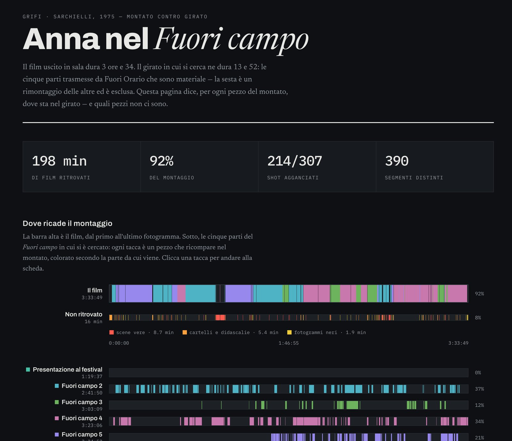
</p>

## La domanda

*Anna* (Grifi, Sarchielli, 1975) dura 3 ore e 34 minuti ed è stato montato a partire da un girato
molto più lungo. Una parte di quel girato si è conservata: Fuori Orario l'ha trasmessa come *Fuori
campo di Anna*, in sei puntate per circa quindici ore. Vogliamo sapere, per ogni pezzo del film,
da quale punto del girato viene, e quanta parte del girato nel film non è mai entrata.

| | |
|---|---|
| **198 min** | di film ritrovati nel girato, su 214 (92%) |
| **214 / 307** | shot agganciati |
| **387 / 390** | segmenti confermati dalla verifica a piena risoluzione (99%) |
| **9,1 h** | di girato che non compare mai nel film (72%) |

Restano 16 minuti non ritrovati. Di questi, 7,3 sono cartelli, didascalie e schermi neri fatti in
montaggio, che nel girato non possono esserci. Gli altri 8,7 sono scene vere: 13 shot, il 3,1% del
film.

> [!NOTE]
> Il codice sta in `fuoricampo/`. Nel repo ci sono gli script, i documenti e i risultati in JSON.
> Mancano i video, le impronte (`dati/`, ~300 MB) e le pagine HTML, che si possono rigenerare.
> Questa parte non modifica la pipeline né `Config`, ne legge solo l'output.

## Input

| Cosa | Da dove | A cosa serve |
|---|---|---|
| `Film/Anna.mp4`, 3:33:49 | il film | il montato, i pezzi da cercare |
| `Fuori campo di Anna - 1…5.mp4`, 13h52 in tutto | Fuori Orario, RAI | il girato, dove cercarli |
| `clips/Anna/manifest.json` | la Parte I | i 307 shot, con descrizioni (Qwen3-VL) e parlato (Whisper) |

| Parte | Durata | Usata? | Perché |
|---|---|---|---|
| FC1 | 1:19:37 | sì, trovato 0% | è la presentazione al festival, cioè il dibattito dopo la proiezione. Che non ci sia nulla del film è il risultato atteso |
| FC2 | 2:41:50 | sì | girato |
| FC3 | 3:03:09 | sì | girato |
| FC4 | 3:23:06 | sì | girato |
| FC5 | 3:24:52 | sì | girato |
| FC6 | ~1:35:00 | no | è rimontata dalle altre parti: il 78% dei suoi minuti è già in FC1–FC5. Tenendola, i pezzi del film venivano agganciati alla copia invece che all'originale |

## Il metodo

Qui non c'è nessun modello addestrato. `ffmpeg` decodifica, NumPy calcola le impronte e un prodotto
di matrici in PyTorch, su MPS, confronta ogni istante del film con ogni istante del girato. Della
Parte I si usano solo i risultati: shot, descrizioni e trascrizioni.

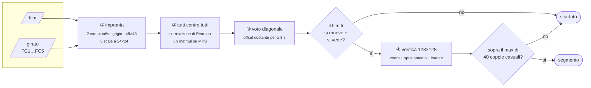

**① Impronta.** Ogni mezzo secondo si prende un fotogramma dal film e uno dal girato, in scala di
grigi e ridotti a 24×24. Sono 576 numeri, portati a media 0 e norma 1: in questo modo il prodotto
scalare fra due impronte è la loro correlazione. Ci sono tre correzioni, ognuna aggiunta dopo un
errore:

- Il crop si misura parte per parte. Le puntate hanno larghezze utili diverse (1151, 1057 e
  1044 px), e `cropdetect` scambia per barra nera qualsiasi scena scura vicino ai bordi. Si usa
  invece il 75° percentile della luminanza di ogni colonna, su 300 frame.
- Si toglie il gradiente lineare. Dopo la normalizzazione una parete grigia con un filo di luce
  correlava 0,93 con quasi tutto, ed era la causa del 90% dei primi falsi positivi.
- Si provano cinque zoom, da 0,70 a 1,0, perché il film è inquadrato più stretto del girato e di
  quanto cambia da ripresa a ripresa. Si estrae una volta a 48×48 e le versioni ridotte si calcolano
  in RAM. Il recall sale dal 6,5% al 70,5%.

**② Tutti contro tutti.** I 25 659 istanti del film contro i circa 100 000 del girato, in un solo
prodotto di matrici: pochi secondi. Per ogni istante del film si tengono i 5 candidati migliori.

**③ Voto diagonale.** Che due fotogrammi si somiglino conta poco, perché il materiale è tutto in
bianco e nero, nella stessa stanza, con le stesse persone. Quello che conta è che la somiglianza
duri: per alcuni secondi di fila, ogni volta che il film avanza di mezzo secondo anche il girato
avanza di mezzo secondo.

<p align="center">
  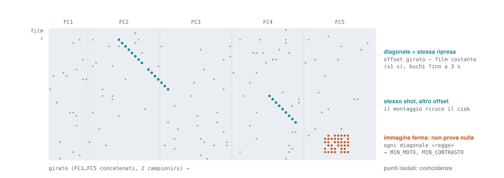
</p>

Con un'immagine ferma, però, il test non funziona. Sei fotogrammi identici del film si allineano
con qualsiasi fila di fotogrammi identici del girato, ed è così che un cartello è stato agganciato a
una targa incisa. Per questo il segmento viene scartato se il film al suo interno non cambia
abbastanza (`MIN_MOTO`) o è quasi nero (`MIN_CONTRASTO`).

**④ Verifica.** L'impronta serve a trovare i candidati. Per confermarli `controllo.py` riprende ogni
segmento a 128×128 e cerca lo zoom, lo spostamento e l'istante che allineano meglio le due immagini.
Per capire quanto vale il punteggio lo stesso calcolo si fa su 40 coppie prese a caso: mediana
0,442, massimo 0,648. I segmenti trovati hanno mediana 0,827, e 387 su 390 superano il massimo delle
coppie casuali.

## Dal 70% al 92%

Il primo giro ritrova il 70% del film. Il resto è arrivato con quattro passi successivi, e ogni
pezzo nuovo è passato dalla stessa verifica a 128×128.

<p align="center">
  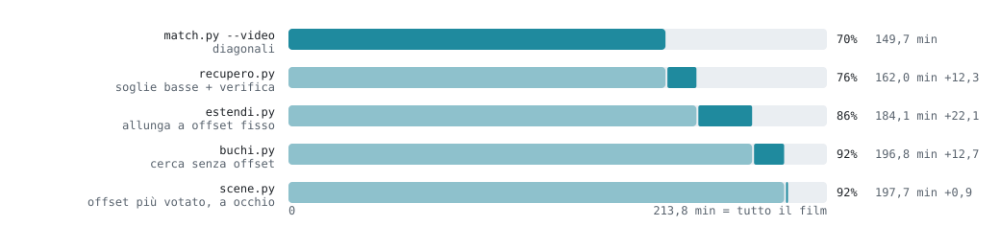
</p>

| Passo | Cosa cerca | Cosa abbiamo imparato |
|---|---|---|
| `recupero.py` | gli shot ancora senza aggancio | sugli shot scoperti si possono abbassare le soglie, perché poi controlla la verifica. 48 candidati confermati su 50 |
| `estendi.py` | il seguito di un segmento già trovato | per riconoscere un pezzo e per allungarlo servono soglie diverse. Appena fuori dal bordo la verifica dà comunque 0,674, quindi con la soglia delle coppie casuali (0,648) l'allungamento non si fermava più |
| `buchi.py` | le parti scoperte di uno shot agganciato a metà | non si può dare per scontato che il pezzo mancante abbia lo stesso offset del vicino: 35 dei 49 pezzi confermati vengono da un altro punto del girato, perché il montaggio ha unito riprese diverse |
| `scene.py` | i primi piani lunghi e quasi fermi | si prende l'offset più votato dai candidati dello shot. Delle 7 proposte 5 erano giuste, e sono entrate solo quelle controllate a occhio. Il guadagno era ormai sotto il minuto |

> [!IMPORTANT]
> Dopo l'allungamento i segmenti si sovrappongono, e sommando le durate si arrivava a 322 minuti su
> un film di 214. La copertura va calcolata come unione degli intervalli: lo fa la funzione
> `copertura` in `timeline.py`, usata da tutte le pagine.

## Comandi

Si lanciano dalla radice del repo con `.venv/bin/python`, in quest'ordine:

| # | Comando | Input | Output | Tempo |
|---|---|---|---|---|
| 1 | `fuoricampo/impronta.py VIDEO fuoricampo/dati` *(una volta per video)* | un `.mp4` | `dati/<nome>.npy`, array `[N, 48, 48]` uint8 | ~15 min in tutto |
| 2 | `fuoricampo/match.py --video` | `dati/*.npy` | `segmenti-video.json`, `candidati.npz`, `run.json` | ~2 min su MPS |
| 3 | `fuoricampo/controllo.py [n]` | segmenti e video | `controllo.json`, il punteggio a 128×128 di ogni segmento | ~2 min |
| 4 | `fuoricampo/recupero.py --applica` | shot senza aggancio | segmenti nuovi, già verificati | |
| 5 | `fuoricampo/estendi.py --applica` | segmenti | segmenti allungati con lo stesso offset | |
| 6 | `fuoricampo/buchi.py --applica` | `candidati.npz` | segmenti nelle parti scoperte degli shot | |
| 7 | `fuoricampo/scene.py --applica --solo=13,19,…` | shot lunghi e fermi | solo gli shot controllati a occhio | |
| 8 | `fuoricampo/artifact.py --offline` | segmenti e manifest | `Anna nel Fuori campo.html` | |
| 9 | `fuoricampo/scartato.py --miniature` | segmenti | `Il girato scartato.html` | |
| 10 | `fuoricampo/lavoro.py` | i sette video | `lavoro/anna-lavoro.html` (usa symlink ai video, funziona solo in locale) | |
| 11 | `fuoricampo/applica_correzioni.py correzioni.json` | l'export della pagina di lavoro | testi in `clips/Anna/manifest.json`, verdetti in `verdetti.json` | |

<details>
<summary><b>Altri script</b></summary>

| Comando | Cosa fa |
|---|---|
| `timeline.py [--miniature]` | `timeline.html` e `relazione.md`, con gli intervalli completi di ogni shot |
| `confronta_run.py PRIMA.json [DOPO.json]` | le differenze fra due run, shot per shot |
| `soglie.py [TH_FRAME TH_SEG MIN_LEN]` | quanti minuti si ritrovano al variare delle soglie, partendo da `candidati.npz` |
| `serve.py [porta]` | un server locale con supporto `Range`, che serve solo per comandare la pagina da un'estensione del browser |
| `verifica.py` · `geometria.py` · `sonda.py` | gli script usati per misurare le ipotesi |
| `impronta_audio.py` | l'impronta sull'audio, abbandonata (vedi sotto) |

Ogni passo, mentre gira, aggiunge una riga a `run.json` (`annota_passo`). In fondo a ogni pagina
c'è quindi da quale run viene: data, soglie, parti usate e conteggi di ogni passo. `match.py
--video` svuota il registro. I path assoluti dei video sono in due punti: `GIRATO` in
`timeline.py`, e `lavoro.py`.

</details>

## Output

<table>
<tr>
<td width="50%" valign="top">
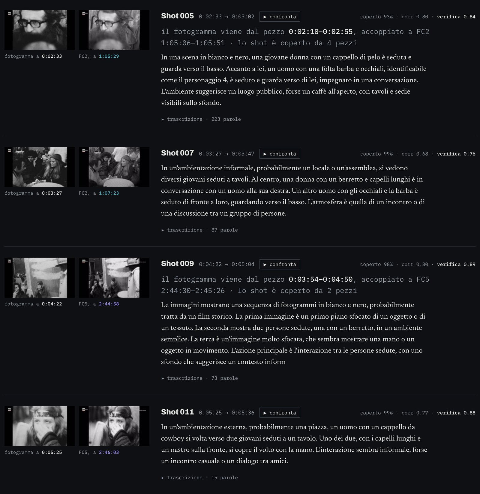
<p><b><code>Anna nel Fuori campo.html</code></b>: per ogni shot, il fotogramma del film accanto a quello
del girato (presi nello stesso istante, al centro della parte in comune), con la parte, il minuto,
la copertura e il punteggio della verifica. È un file unico con immagini e font dentro, e si può
mandare per mail.</p>
</td>
<td width="50%" valign="top">
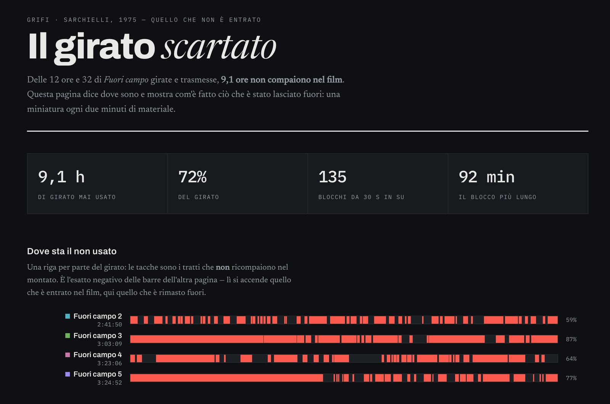
<p><b><code>Il girato scartato.html</code></b>: le parti del girato che non compaiono nel film,
divise per puntata. Sono 135 blocchi da almeno 30 s, con una miniatura ogni due minuti. FC1 non è
contata, perché non è girato.</p>
</td>
</tr>
</table>

La pagina di lavoro (`lavoro/anna-lavoro.html`) mostra i due video affiancati: film e girato partono
dallo stesso istante e restano allineati regolando la velocità di riproduzione (±12%) invece di
saltare. Per ogni aggancio puoi dare un verdetto e correggere descrizioni e trascrizioni.
`applica_correzioni.py` riporta poi le correzioni nel manifest della Parte I, abbinandole per
`start_frame` e mai per indice. Le correzioni che non trovano più il loro shot vengono elencate e
lasciate da parte.

## Parametri

| Costante | Valore | File | Significato |
|---|---|---|---|
| `FPS` | 2 | `impronta.py` | campioni al secondo (gli shot di *Anna* durano in media 42 s) |
| `LATO` · `SCALE` | 24 · da 0,70 a 1,0 | `impronta.py` | lato dell'impronta e zoom provati |
| `TOPK` | 5 | `match.py` | candidati per istante |
| `TH_FRAME` | 0,70 | `match.py` | correlazione minima per partecipare al voto |
| `TH_SEG` | 0,80 | `match.py` | correlazione mediana minima di un segmento |
| `TOL` · `MAX_GAP` · `MIN_LEN` | ±1 s · 3 s · 3 s | `match.py` | scarto ammesso sull'offset, buco tollerato, durata minima |
| `MIN_MOTO` | 0,012 | `match.py` | i cartelli stanno fra 0,000 e 0,003, le inquadrature vere fra 0,018 e 0,318 |
| `MIN_CONTRASTO` | 15 | `match.py` | deviazione standard minima. I due falsi agganci su schermo nero stavano a 12,5 e 13,4 |
| `SOGLIA_VERA` | 0,648 | `recupero.py` | il punteggio massimo delle 40 coppie casuali |

Le soglie sono basse apposta. Alzandole a 0,85/0,88 i minuti ritrovati scendono da 198 a 50, e
guardando a occhio la precisione non migliora. Abbassando le soglie i minuti salgono sempre, quindi
vanno letti insieme ai punteggi della verifica.

## Ipotesi smentite

1. **«Il crop è lo stesso in tutte le puntate.»** Le larghezze utili sono 1151, 1057 e 1044 px, e
   con un crop unico il confronto non trova quasi niente.
2. **«Basta che due frame si somiglino.»** Dopo la normalizzazione anche un'immagine quasi vuota
   correla bene con molte altre. Servono il voto diagonale e `MIN_MOTO`.
3. **«L'audio funziona meglio, è presa diretta.»** Ha dato 289 segmenti, tutti sbagliati. Due voci
   registrate nella stessa stanza correlano 0,87 anche quando le frasi sono diverse, e nel film
   l'audio è stato rimissato.
4. **«La correlazione delle forme d'onda basta per decidere.»** Funziona solo su finestre corte.
   Fra le due copie c'è uno 0,02% di differenza di velocità: su 30 s diventa uno sfasamento di 6 ms,
   e la correlazione scende da 1,000 a 0,085.

La storia completa, scritta per chi non è del mestiere, è in `fuoricampo/Come è stato fatto.md`.
Tutti i numeri sono in `fuoricampo/README.md`.

**Limiti.** I confini dei segmenti hanno un errore di ±0,5 s (il campionamento) e ±1 s (il voto):
vanno bene per una timeline, non per rimontare. Gli shot non ritrovati possono essere sotto soglia,
avere uno zoom fuori dai cinque provati o stare in una puntata mai trasmessa.

<br>

# Glossario

I termini di cinema, i modelli e le misure che compaiono in questo README. Dove possibile c'è un
esempio preso dal progetto.

## Film e video

**Shot** *(inquadratura)*: un tratto di ripresa continua fra due tagli, l'unità del catalogo. Uno
shot si identifica col suo range `(start_frame, end_frame)`. La posizione in lista cambia ogni volta
che nella UI tagli o unisci uno shot, il range resta. `end_frame` è incluso nello shot.

**Scena**: un gruppo di shot consecutivi nello stesso luogo, tempo e azione. Il campo e controcampo
di un dialogo, per esempio, sono più shot di una sola scena.

**Stacco netto** *(hard cut)*: il passaggio da uno shot all'altro da un frame al successivo. Come
transizione occupa 2 frame, l'ultimo dello shot che finisce e il primo di quello che comincia.

**Transizione graduale**: un passaggio che dura più frame. La dissolvenza sovrappone le due immagini
e la prima sfuma nella seconda. Il fade passa per il nero. Poi ci sono le tendine. La durata in frame
si salva in `Scene.transition`.

**Montato e girato**: il montato è il film finito, il girato è tutto il materiale ripreso da cui il
film è stato tagliato. Per *Anna* il girato è molte volte più lungo.

**fps e frame**: i fotogrammi al secondo, di solito 23,976, 25 o 29,97. Il progetto misura il tempo
in frame. A 23,976 fps un tempo arrotondato al millisecondo può finire sul frame accanto.

**Keyframe e GOP**: un video compresso salva interi solo alcuni frame, i keyframe, e per gli altri
salva le differenze. Il GOP è la distanza fra due keyframe, di solito 1 o 2 secondi. Copiando lo
stream si può tagliare solo su un keyframe. Ricodificando si taglia dove si vuole.

**ASL** *(Average Shot Length)*: la durata media degli shot, la misura più usata per il ritmo del
montaggio. *Anna* ha una media di 41,8 s e una mediana di 19,9 s: alcuni shot lunghissimi alzano
molto la media.

**Diarizzazione**: capire chi parla e quando. Cosa dice lo ricava l'ASR, la trascrizione.

**EDL e SRT**: l'EDL (CMX3600) è una lista di montaggio in formato testo che Premiere e Resolve
importano. L'SRT è il formato dei sottotitoli.

**Crop e ricadramento**: il crop taglia le barre nere ai bordi. Si parla di ricadramento quando due
copie della stessa immagine ne mostrano porzioni diverse. Il film è inquadrato più stretto del
girato, con uno zoom fra 0,70 e 0,96 che cambia da ripresa a ripresa.

## I modelli

| Modello | Cos'è | Cosa fa qui |
|---|---|---|
| **TransNetV2** | una rete neurale convoluzionale 3D. Le sue convoluzioni lavorano sull'immagine e anche sul tempo, e così vedono decine di frame alla volta. Lavora a 48×27 px | dà a ogni frame la probabilità di essere una transizione. Gli shot li ricava poi il post-processing |
| **PySceneDetect** | un algoritmo classico, senza pesi. Confronta i colori (in HSV) di frame consecutivi e mette un taglio dove la differenza supera una soglia | è la baseline: non richiede setup, funziona bene sugli stacchi netti e male sulle dissolvenze |
| **SCRFD** | il rilevatore di volti di InsightFace | per ogni volto restituisce un riquadro, cinque punti (occhi, naso, angoli della bocca) e un punteggio `det_score` |
| **ArcFace** | una rete addestrata in modo che i volti della stessa persona diano vettori con la stessa direzione | trasforma ogni volto, allineato coi cinque punti, in un embedding di 512 numeri. Persone diverse danno direzioni diverse |
| **`buffalo_l`** | il pacchetto di InsightFace con dentro SCRFD e ArcFace | ha una licenza solo non commerciale |
| **DINOv2** | un Vision Transformer di Meta, addestrato senza etichette su immagini di ogni tipo | con `--faces-refine` calcola un embedding della figura intera quando il volto non è umano (droidi, elmetti). Sopra c'è uno strato lineare, addestrato in pochi secondi sui personaggi già riconosciuti con sicurezza |
| **Whisper** `large-v3-turbo` | il modello di trascrizione di OpenAI, un transformer encoder-decoder. La versione *turbo* ha un decoder più piccolo ed è molto più veloce | trascrive i dialoghi. Gira con CTranslate2, quantizzato int8, sulla CPU |
| **VAD Silero** | un modello piccolo che trova i tratti di un audio dove qualcuno parla | divide il parlato in finestre da 30 s e lascia fuori musica e silenzi |
| **Qwen3-VL-8B** | un modello visione-linguaggio (VLM) di Alibaba: legge immagini e testo e risponde in testo. *4bit* vuol dire pesi quantizzati a 4 bit, circa 5 GB invece di 16 | scrive una o due frasi in italiano per ogni shot. Gira con MLX sulla GPU dei Mac |
| **OSG** | *Optimal Sequential Grouping*, un algoritmo di programmazione dinamica. Non è addestrato | divide la sequenza degli shot in K gruppi consecutivi, i più omogenei possibile: le scene |

I runtime sono i programmi che eseguono i modelli. Qui sono PyTorch su MPS (la GPU dei Mac), ONNX
Runtime su CoreML, CTranslate2 sulla CPU e MLX, il framework di Apple per Apple Silicon.

## Misure e statistiche

### Trovare i tagli

**Probabilità per frame**: il numero fra 0 e 1 che TransNetV2 assegna a ogni frame. In uno stacco
netto il valore più alto cade sull'ultimo frame dello shot che finisce.

**Soglia** (`--threshold`, 0,05): i frame che la superano si dicono «caldi». La soglia stabilisce
dove una transizione comincia e dove finisce.

**Corsa**: una serie di frame caldi consecutivi. Tutta la corsa è una transizione sola.

**Picco** (`--min-peak`): il valore più alto dentro una corsa. Serve a decidere se il taglio c'è
davvero. In *Anna* le corse con picco sotto 0,5 erano disturbi della pellicola.

**Confidenza**: la probabilità del taglio che apre uno shot. Più è bassa, più il confine è incerto.
La coda *⚑ rivedi* è ordinata in base a questo valore.

### Valutare un detector

**Ground truth**: i tagli segnati a mano da una persona, usati come riferimento. Qui vengono da
dataset pubblici: SHOT, ClipShots, RAI.

**TP, FP, FN**: i veri positivi sono i tagli trovati che esistono davvero. I falsi positivi sono
tagli trovati che non esistono. I falsi negativi sono tagli veri che il detector non ha trovato.

**Precision, recall e F1** si calcolano da TP, FP e FN:

```text
precision = TP / (TP + FP)        quanti dei tagli trovati sono veri
recall    = TP / (TP + FN)        quanti dei tagli veri sono stati trovati
F1        = 2·P·R / (P + R)       media armonica: è alta solo se lo sono tutte e due
```

Con una soglia più bassa il recall sale e la precision scende, quindi vanno sempre guardate insieme.

**Tolleranza** (`tol`): un taglio trovato conta come giusto se cade entro `tol` frame da uno vero.
Due F1 calcolati con `tol` diverse non sono confrontabili.

**IoU** *(Intersection over Union)*: misura quanto si sovrappongono due intervalli, dividendo la
parte in comune per l'unione. Una dissolvenza vera di 24 frame e un taglio secco di 2 frame nel suo
mezzo danno IoU = 2 / 24 = 0,083. L'F1 sui punti, nello stesso caso, vale 1,00.

**Transition IoU e mean IoU**: una transizione trovata conta come TP se il suo IoU con una vera è
almeno `min_iou` (0,5). Il mean IoU è la media su tutte le coppie abbinate, e dice quanto bene il
detector trova l'inizio e la fine delle transizioni.

**Aggregazione micro**: si sommano TP, FP e FN di tutti i video e solo alla fine si calcolano
precision, recall e F1. Così un video con 58 tagli pesa più di uno con un taglio solo. L'aggregazione
macro, invece, fa la media dei risultati dei singoli video.

### Somiglianza e raggruppamento

**Embedding**: una lista di numeri che descrive un oggetto, per esempio un volto, in modo che oggetti
simili abbiano vettori vicini.

**Similarità coseno**: il coseno dell'angolo fra due embedding. Vale 1 se puntano nella stessa
direzione e 0 se non hanno niente in comune. Se i vettori hanno lunghezza 1 (normalizzazione L2) è
semplicemente il loro prodotto scalare. Con `--faces-threshold 0.5` due volti si uniscono se la
similarità è almeno 0,5.

**Clustering agglomerativo greedy**: si prende un volto alla volta e lo si mette nel gruppo più
simile, se supera la soglia. Altrimenti diventa un gruppo nuovo. Il numero di gruppi non è deciso in
anticipo.

**Must-not-link**: la regola che due elementi non possano stare nello stesso gruppo. Due volti nello
stesso fotogramma sono per forza due persone diverse, anche se si somigliano.

### Il confronto fra montato e girato

**Impronta** *(fingerprint)*: un fotogramma ridotto a 24×24 pixel in grigio. È abbastanza piccola da
permettere di confrontare quindici ore di video in pochi minuti. La conferma si fa poi a risoluzione
più alta.

**z-score**: si sottrae la media e si divide per la deviazione standard. Toglie le differenze di
luminosità e contrasto fra due copie della stessa immagine. Se poi si porta il vettore a lunghezza
1, il prodotto scalare fra due impronte è la correlazione di Pearson.

**Correlazione di Pearson**: un numero fra −1 e 1. Vale 1 se due immagini sono uguali a parte
luminosità e contrasto, 0 se non c'è relazione.

**Offset**: la differenza fra l'istante nel girato e l'istante nel film. Se resta costante per
alcuni secondi di fila, si vede come una diagonale nella matrice film × girato, ed è la stessa
ripresa.

**Moto** (`MIN_MOTO`): quanto cambia il film da un campione al successivo, calcolato come 1 meno la
correlazione fra i due. Con un'immagine ferma è vicino a 0, e in quel caso la diagonale non prova
niente.

**Contrasto** (`MIN_CONTRASTO`): la deviazione standard dei pixel, calcolata prima della
normalizzazione. Un fotogramma quasi nero sta sotto 15 e si abbina bene con qualsiasi cosa.

**Distribuzione nulla e controlli casuali**: i punteggi che si ottengono confrontando coppie prese a
caso. Servono a capire se un punteggio alto vuol dire qualcosa. Qui 40 coppie casuali hanno mediana
0,442 e massimo 0,648: un aggancio con punteggio più alto di 0,648 non si spiega col caso.

**Mediana e percentile**: la mediana è il valore che sta a metà quando li ordini, e risente poco dei
valori estremi, al contrario della media. Il 75° percentile è il valore sotto cui sta il 75% dei
dati. Il crop si calcola col 75° percentile della luminanza di ogni colonna, perché così una scena
scura non lo falsa.

**Copertura**: la parte del film ritrovata, calcolata come unione degli intervalli. Se si sommano
le durate, due segmenti sovrapposti vengono contati due volte. Sommando si arrivava a 322 minuti su
un film di 214.

<br>

# Crediti e licenze

Il codice di questo progetto è rilasciato con licenza MIT, vedi [`LICENSE.txt`](LICENSE.txt). I
componenti di terze parti hanno le loro licenze:

| Componente | Autori | Licenza |
|---|---|---|
| [TransNetV2](https://github.com/soCzech/TransNetV2) | Souček & Lokoč | MIT, copiato in `detection/models/` |
| [PySceneDetect](https://github.com/Breakthrough/PySceneDetect) | Castellano | BSD-3 |
| [InsightFace](https://github.com/deepinsight/insightface) | Deng et al. | codice MIT |
| [faster-whisper](https://github.com/SYSTRAN/faster-whisper) | SYSTRAN | MIT |
| [mlx-vlm](https://github.com/Blaizzy/mlx-vlm) · [Qwen3-VL](https://github.com/QwenLM/Qwen3-VL) | Blaizzy · Alibaba | MIT · Apache-2.0 |
| [DINOv2](https://github.com/facebookresearch/dinov2) | Meta AI | Apache-2.0 |
| [SHOT dataset](https://github.com/wentaozhu/AutoShot) *(solo benchmark)* | Zhu et al., CVPR-W 2023 | MIT |
| Archivo · Newsreader · IBM Plex Mono *(nella UI)* | | SIL OFL |

> [!CAUTION]
> Il pacchetto di modelli `buffalo_l` di InsightFace ha una licenza separata da quella del codice
> MIT, e ne permette l'uso solo per ricerca non commerciale.

Il codice senza licenza non viene copiato nel repo: lo scarica il setup, come i pesi. I fotogrammi
in `docs/img/` vengono da *Anna* (1975) e dal *Fuori campo di Anna*, sono usati qui solo per
documentare il progetto e restano soggetti ai diritti dei proprietari.
